# Design review — October 2026

A full design pass over the site, based on the running app (dev server against the
production CMS) at 1440×900 desktop and 390×844 mobile, plus a read of every
component and stylesheet. Screenshots are in [`docs/design-review/`](./design-review).

Every finding has an ID so you can pick what to act on (e.g. "do F1, F3, P1–P4").
Each one is tagged with **impact** (high / med / low) and **effort** (S = under an
hour, M = a few hours, L = a day or more).

---

## TL;DR — what I'd do first

1. **F1 Button system** and **F2 Responsive type scale** — cheapest way to make every page feel consistent.
2. **P1 Project cards are hover-only** — on touch devices the "veure més" link is effectively hidden.
3. **X1 Orange contrast** — white-on-orange and orange-on-white text fails WCAG AA for body sizes across the footer, buttons and links.
4. **N1 Navigation uses `onClick` instead of links** — no hrefs, so no open-in-new-tab, no crawlable links, weak keyboard support.
5. **G1 Cookie banner** — off-brand library default, English-only, covers content on every page, and doesn't actually gate the third-party embeds.
6. **S1–S4 Single project page** — the page where clients actually land from social; currently the least polished.

---

## Foundations

### F1 — No button system · high · M
Buttons are styled per page in SCSS (`.see-more-button`, `.see-projects-button`,
`.see-services-button`, `.about-us-button`, `.remove-filter-button`, plus inline
`sx={{ borderRadius: 0 }}`), each re-declaring colours, hover inversion and
`border-radius: 0`. The result is visibly inconsistent: "TOTS ELS PROJECTES" is a
small regular-weight button, "CARREGAR MÉS" is bold, "VEURE MÉS" on the cards is a
different size again, and the hover inversion (orange → white) only exists on some.

**Proposal:** define the button look once in `utils/theme.ts` (`components.MuiButton`:
`disableElevation`, `borderRadius: 0`, one font weight, a `primary` and an
`inverted`/`outlined` variant), then delete the per-page overrides.

### F2 — Heading sizes don't scale on mobile · high · S
Page titles use `variant="h3"` (3rem) at every width, so on a 390px screen
"els nostres projectes" and "els nostres serveis" take two lines and ~250px of the
first viewport (`mobile-projects-fold.jpg`). "Experts en SPORTS MARKETING…" on the home
page becomes a seven-line wall (`mobile-home-full.jpg`).

**Proposal:** wrap the theme in MUI's `responsiveFontSizes()` and define the
`h1`–`h6` scale explicitly. One-line change with a big effect.

### F3 — Heading semantics are visual-only · med · S
No page has an `<h1>`. Page titles are `h3`, sections are `h3`/`h4`, card titles `h4`,
and markdown-rendered CMS headings produce stray `h1`/`h2`s in the middle of the home
page. Use `component="h1"` on page titles (keeping the visual variant) and map
markdown headings down a level in `RenderMarkdown`.

### F4 — Inconsistent page gutters and widths · med · S
Horizontal padding is 36px (Projects, Services, About), 16px (Single project), 24px
(404) and 40px (Legal). Home constrains content to `maxWidth="lg"`; the other pages run
full-bleed, so on wide screens body copy lines reach ~170 characters (Legal, About).

**Proposal:** a single `PageContainer` (MUI `Container maxWidth="lg"` + one gutter
value) used by every page, and a `max-width: 70ch` on long-form text.

### F5 — Theme only defines the primary colour · low · S
`theme.ts` sets `primary.main` only; black, the grey (`$secondary-color`, unused) and
the translucent orange live in `colors.scss`, and `#ff521c` is hard-coded again in
`SingleProject` and `theme.ts`. Put the palette in the theme (`primary`, `secondary`,
`text`, `background`) and generate the SCSS variables from the same values, or read
them as CSS variables (MUI v5's `experimental_extendTheme` + `CssVarsProvider`, or
just `:root` custom properties shared by both).

### F6 — Casing is inconsistent · low · S
Page titles are lowercase ("els nostres projectes"), nav is uppercase, filter label is
lowercase ("filtra per") next to uppercase buttons, service titles are lowercased in
code (`name.toLowerCase()`) while service tiles are uppercased (`toUpperCase()`).
Pick a rule (e.g. lowercase display headings as a brand trait, uppercase only for
labels/buttons) and apply it with `text-transform` in the theme rather than in JS,
which also breaks screen-reader pronunciation of uppercased text.

---

## Global elements

### G1 — Cookie banner · high · S
`react-cookie-consent` default styling: grey bar, yellow "I understand" button,
Arial font, English text on every locale. It covers the bottom ~60px on desktop and
~280px on mobile, hiding the hero copy and the first team member on About.

The app itself sets no cookies (the only storage is `localStorage.locale`), but the
Instagram and YouTube embeds on project pages set third-party cookies, and the banner
neither blocks them nor offers a reject option — so today it's decorative.
**Proposal:** restyle it to the brand, translate it, add a reject button, and gate the
embeds on consent (show a "load Instagram/YouTube content" placeholder otherwise —
pairs with S5). YouTube's `youtube-nocookie.com` domain avoids cookies for videos.

### G2 — Footer · med · S
- On mobile the legal links are hidden entirely (`!isMobile &&`); they're only
  reachable via the drawer.
- Footer text is white on orange at 16px — fails contrast (see X1).
- Social icons have hover backgrounds but the email link doesn't match them.
- No logo, no copyright line. Consider a two-row footer: logo + tagline, then links.

### G3 — Loading states · med · M
Loading is a bare `CircularProgress` in the top-left corner (About, Services, Single
project — the latter with a hard-coded colour). The page then jumps when content
arrives. Use MUI `Skeleton`s shaped like the content (cards, hero block), or at least
centre the spinner in a min-height area.

### G4 — No error or empty states · med · S
If a CMS call fails, About crashes (`data.data` on undefined); other pages render
empty. Filtering Projects to a month with no projects shows a blank area with no
message. Add a shared "couldn't load" and "no projects match" state.

### G5 — Document title and `lang` never change · med · S
Every page is titled "Cordada Outdoor" and `<html lang="en">` is fixed even when the
content is Catalan. Set `document.title` per page (a tiny `usePageTitle` hook) and
update `document.documentElement.lang` in the `Routes` language effect. Also update
`manifest.json` — it still says "Create React App Sample".

---

## Navigation

### N1 — Nav items are buttons, not links · high · S
Desktop and mobile navigation use `ListItemButton onClick={() => history.push(...)}`.
There are no `href`s, so you can't open a section in a new tab, crawlers don't see the
links, and screen readers announce them as buttons. Use
`ListItemButton component={Link} to={...}` (same visuals).

### N2 — Desktop logo isn't clickable · med · S
The top-right logo does nothing on desktop (it links home on mobile). Make it a home
link, and consider moving it to the left — logo-right, nav-left is unusual and the
hero already shows a large logo, so the two compete.

### N3 — Active state is ambiguous · low · S
The current page and the current language both use the same white pill with orange
text, so "PROJECTES" and "CAT" look like the same kind of thing. Use an underline (or
orange text only) for the active page, and keep the pill for the language toggle — or
vice versa. Active-page detection uses `window.location.pathname.includes(...)`,
which isn't reactive; use `useLocation`.

### N4 — Mobile menu · med · S
- The trigger reads "CAT >" next to the hamburger, which looks like a breadcrumb.
  Drop the label or show it inside the drawer only.
- The drawer has no close button, no logo and no active-page indicator
  (`mobile-drawer.jpg`).
- The top-left logo is an SVG with `onClick`, not focusable by keyboard.

---

## Home

### H1 — Hero copy is below the fold · med · S
The hero is 115vh, so the tagline ("A la muntanya no t'encordes a qualsevol") starts at
the very bottom edge on desktop and is covered by the cookie banner
(`desktop-home-fold.jpg`). Either reduce to 100vh with the copy overlaid in the lower
third, or add a scroll cue.

### H2 — Hero images are served full size · med · S
`getHomeImagesArr` calls `getImageUrl(image)` without a size, so the hero downloads
the original upload. Use `large` plus `srcSet` for the bigger widths.

### H3 — Section rhythm · low · M
The black → orange gradient stretches across projects and clients, leaving a large
empty band under the logo marquee (`desktop-home-full.jpg`). "Sobre nosaltres" is a
lone button floating in the middle of a photo. Suggest: tighter vertical rhythm (one
spacing token for section padding), and turning the about block into a short
caption + button aligned with the content grid.

### H4 — Mobile project carousel · low · S
Only one project is visible with slick's default arrows overlapping the card edges and
no position indicator. A horizontal scroll-snap row (shows a peek of the next card) is
more discoverable and lighter than slick.

---

## Projects list

### P1 — Cards are hover-only · high · M
Title/description and the "veure més" button only appear on `:hover`. On touch
devices tapping a card did nothing visible in the emulated-touch test; in real mobile
browsers you get, at best, a two-tap interaction (first tap triggers `:hover`). Only the small button is
a link — the card itself isn't.

**Proposal:** make the whole card a `Link`, keep the hover reveal as enhancement only
on `@media (hover: hover)`, and drop the in-card button.

### P2 — Two-line titles push the client line out of the card · med · S
"Choose Your Experience", "Alpine Experience" and "Marató de València 25" wrap and the
"CLIENT X CORDADA" line gets clipped (`desktop-projects-full.jpg`). Clamp titles to two
lines (`-webkit-line-clamp`) and size the overlay to its content. The hover
description is set at `line-height: 1.1rem`, which makes it cramped.

### P3 — "X CORDADA" with no client · low · S
Projects without a client render " X CORDADA". Hide the line when there's no client.

### P4 — Filter UX · high · M
- Each filter opens its own modal; you can only see/edit one at a time.
- The modal has no title, and the close control is a lowercase "x" typed as text.
- The date picker shows month numbers ("01"…"12") although month names exist in code.
- Active filters appear as chips that can't be removed; you have to reopen the modal
  and press "Treure filtre".
- Coming from Services → "veure projectes" filters the list but shows no chip, so the
  user can't tell why the list is shorter (`filtersTitle` isn't set for the
  location-state filter).

**Proposal:** an inline filter bar — three MUI `Select`s (type, client, year/month) or
chip groups — with deletable chips and a "clear all". Put filters in the URL query
string so filtered views are shareable and survive refresh.

---

## Single project

### S1 — Header · high · S
The title sits flush under the navbar with 16px padding, different from the rest of
the site. The banner is `max-height: 300px` of a full-width image, so the crop is
arbitrary (at 1440px only the middle strip of the image is shown). Clicking the banner
opens a modal of the same image with no affordance that it's clickable.

**Proposal:** same page container as other pages; a fixed aspect-ratio banner
(`aspect-ratio: 21/9`, `object-fit: cover`) with an optional focal point from the CMS;
drop the click-to-enlarge or add it to the gallery.

### S2 — Metadata and body layout · med · S
The metadata table (Client / Data / Tipus) misaligns when a value wraps (labels
centre vertically). The body is 6/12 columns on large screens, leaving the right
quarter empty. The bold orange subtitle runs four lines and reads like a heading.

**Proposal:** metadata as a `<dl>` row of label/value pairs above the body; body at
8/12 (or `70ch`) centred; subtitle in regular weight, larger size, black.

### S3 — Gallery · med · M
The gallery is a fixed 450×450 box (300px on mobile), so portrait photos get heavily
cropped. The lightbox has no close button, no "3 / 6" counter, no keyboard arrows, and
the arrow buttons are translucent white on light photos (`desktop-gallery-lightbox.jpg`).
Consider a full-width masonry/grid and a lightbox with close, counter and keys.

### S4 — Page ends abruptly · med · S
After the client logo (an unlabeled black circle) the page ends. Add a "back to
projects" link and next/previous project, and reuse `ContactUs` as the closing CTA —
the `.contact-container` style already exists but isn't used.

### S5 — Instagram embed placeholder · low · S
Instagram embeds render as a ~250×470 blank bordered box until (and unless)
Instagram's script loads — in our headless run it never filled. Give the wrapper a
neutral placeholder with "View on Instagram" fallback link.

---

## Services

### V1 — Section spacing and alignment · med · S
Each service block has 100px vertical margin plus the grid gap, producing long empty
stretches (`desktop-services-full.jpg`). Titles are centred while the body is
left-aligned. Tighten the margins and left-align titles with the copy.

### V2 — "Veure projectes" button over the photo · low · S
The button sits in the bottom corner of each photo, alternating sides, small and with
the same white-on-orange contrast issue. Move it under the text as a proper CTA.

### V3 — Tiles are `div`s with `onClick` · med · S
The service tiles aren't focusable or announced as links; use anchor links to
`#service-id` (the smooth scroll already works via CSS). The "Consulta'ns" tile reuses
the home background image, so it looks like a seventh service rather than a CTA —
style it differently (solid orange, icon).

---

## About

### A1 — Scroll-reveal animations · med · S
About and Services sections start hidden and slide in from ±20vw. They also **re-hide
whenever they leave the viewport** (`setVisible(entry.isIntersecting)`), so scrolling
back up replays every animation. There's no `prefers-reduced-motion` handling and the
observers are never disconnected.

**Proposal:** reveal once (`unobserve` after first intersection), reduce the travel
distance (~24px), and disable under `prefers-reduced-motion`. Extract a shared
`useRevealOnScroll` hook — the logic is duplicated in two components.

### A2 — Team layout · low · S
Names and bios are vertically centred against the 300px avatars, so short bios float
with large gaps. No role/title under the name. Consider a three-column card grid on
desktop (avatar, name, role, bio), which also removes the zig-zag.

---

## Legal & 404

### L1 — Legal pages are Spanish-only and hard-coded · med · M
Avís legal and Política de privacitat render Spanish copy on every locale, in JSX.
Move them to the CMS (like other long-form content) so they can be translated and
edited. Visually they use a light-weight `h3` and uppercase `h5`s that don't match
the rest of the site, and lines run full width (see F4).

### L2 — 404 page · low · S
Two lines of body text, no heading, no link (`desktop-notfound-fold.jpg`). Add a
heading, a short message and buttons to Home/Projects; "podeu contactar amb
nosaltres" should be a `mailto:` link.

---

## Accessibility

### X1 — Orange contrast fails WCAG AA for normal text · high · S
`#ff521c` vs white is **3.24:1**; AA needs 4.5:1 for text under 24px (18.66px bold).
Affected: footer text and links, all white-on-orange buttons (14px), the home
services section body copy, orange links in markdown, orange project metadata values.
Black on orange is 6.5:1 and passes.

**Options:** (a) a darker orange for text and small UI (e.g. `#d63d0a`, ≈4.6:1 with
white) while keeping `#ff521c` for large type and fills; (b) black text on orange
surfaces; (c) larger/bolder button text so it qualifies as large.

### X2 — Missing alt text · med · S
Every project card, service tile, About avatar and most client logos have empty or
missing `alt` (e.g. 9/9 images on Projects, 11/11 on Services). Several use `Avatar`
with `src` only. Pass the project/service/client name, or the Strapi
`alternativeText`. Decorative hero `alt="home-bg"` should be `alt=""`.

### X3 — Keyboard focus · med · S
Focus rings exist on MUI buttons but the custom clickable `div`s (service tiles,
date-picker months, gallery cells, mobile logo) aren't focusable at all. Gallery and
lightbox can't be operated by keyboard.

### X4 — Invalid DOM from `RenderMarkdown` · low · S
Markdown is rendered inside a `Typography` (a `
`), so CMS paragraphs, headings and
lists produce `

`, `
<h1>` etc. — React warns on every page and screen readers
get a broken structure. Render with `Typography component="div"` and map markdown
elements to `Typography` variants via `markdown-to-jsx` `overrides`.

---

## Bugs found along the way

These aren't design, but they showed up during the review:

- **B1** Missing `key`s in `RenderMarkdown`, `About` and `Services` lists; duplicate
  keys on Projects (`key={i}` uses the page index, so all cards in a page share it).
- **B2** `<tr>` directly inside `<table>` on Single project (no `<tbody>`).
- **B3** `window.history.replaceState({}, "")` runs on every render of Projects.
- **B4** `getUrlWithoutLang` uses `replace("/ca")`, which also strips it from paths
  that contain it elsewhere (e.g. `/project/catalunya…`).
- **B5** `i18n.js` has `debug: true`, logging to the console in production.
- **B6** `project?.gallery?.length && <ProjectGallery … />` renders a literal `0` on
  the page when a project has an empty gallery array.
- **B7** Lint warning: unnecessary escape in the embed regex (`utils/index.ts`).

---

## Screenshots

| | |
|---|---|
| Desktop home (fold) | 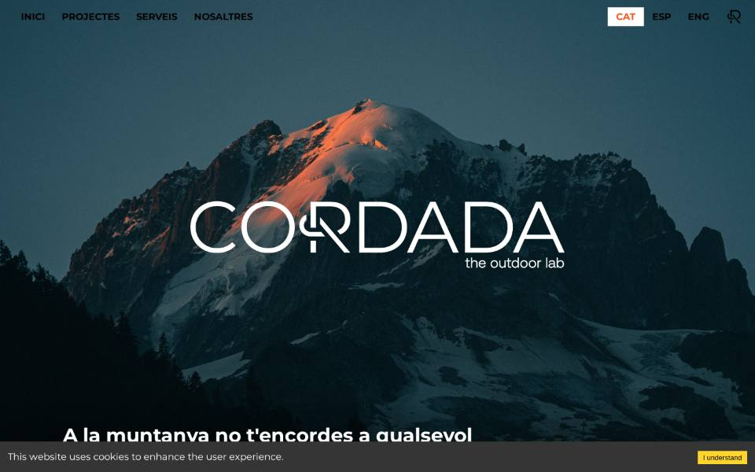 |
| Desktop home (full) | 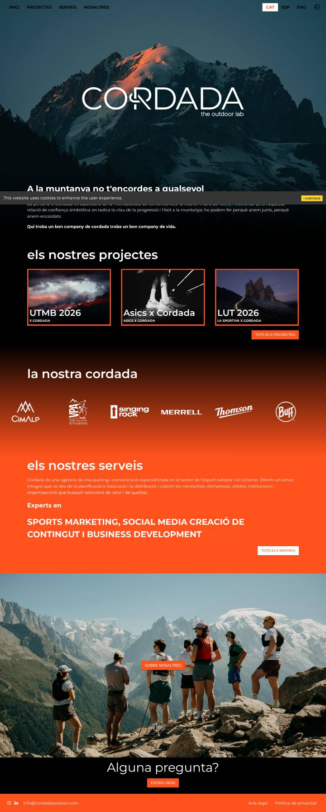 |
| Projects | 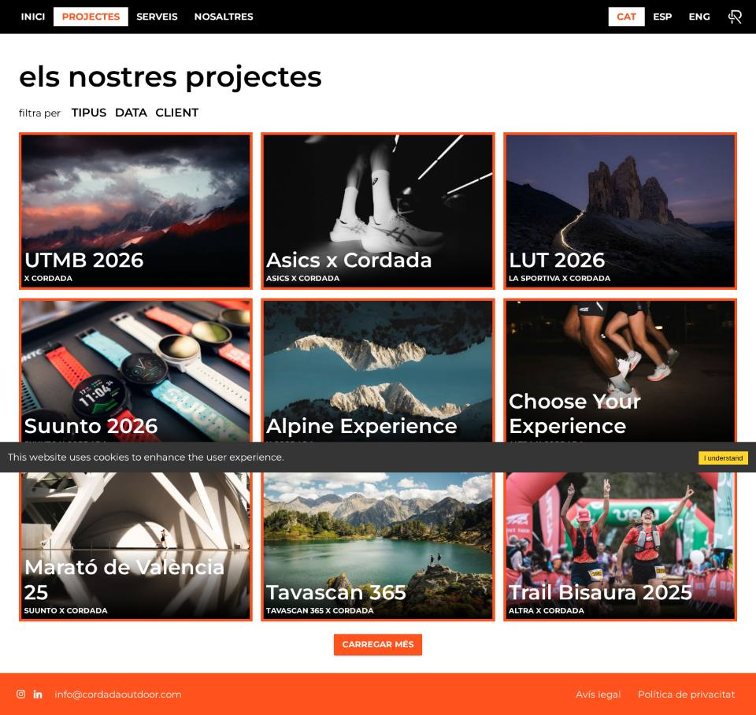 |
| Projects card hover | 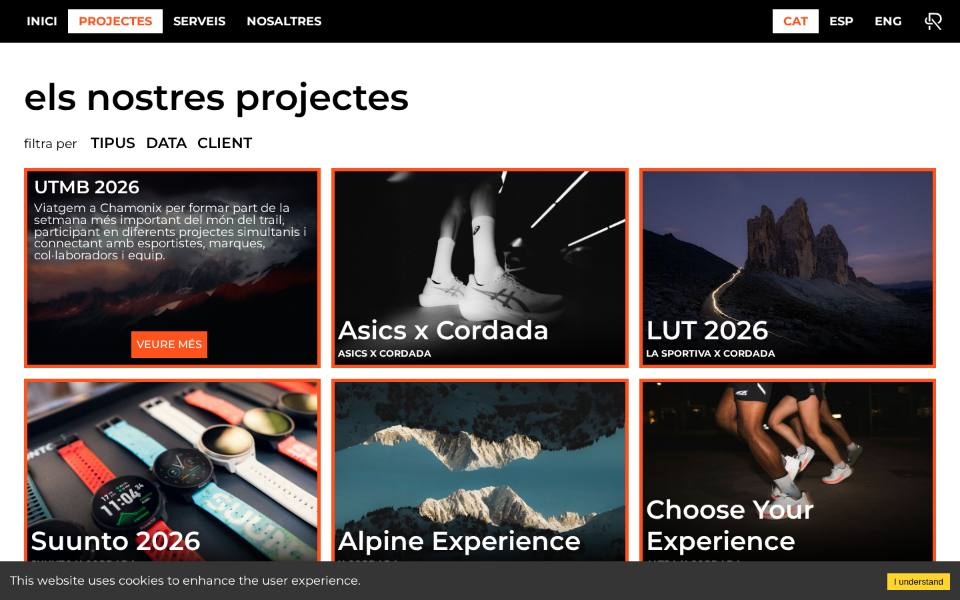 |
| Date filter | 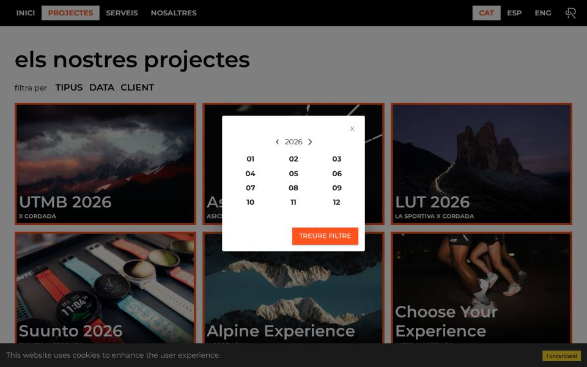 |
| Services | 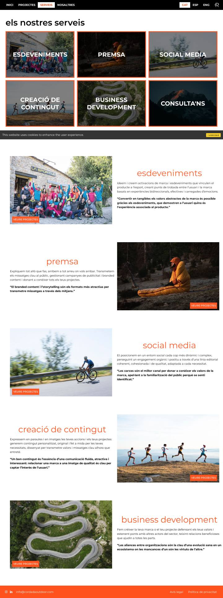 |
| About | 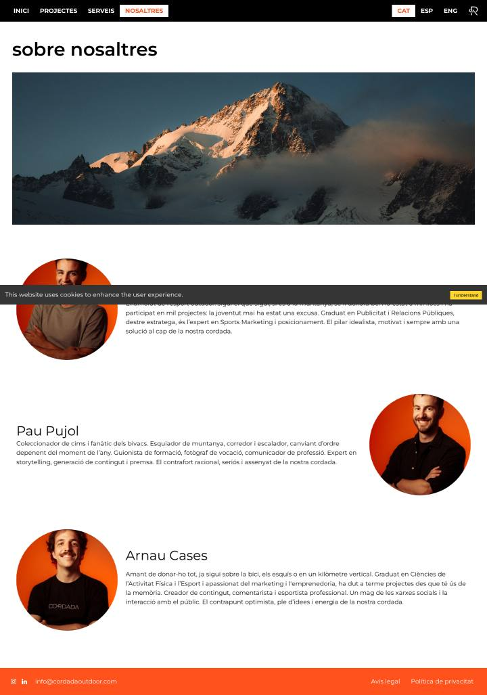 |
| Single project | 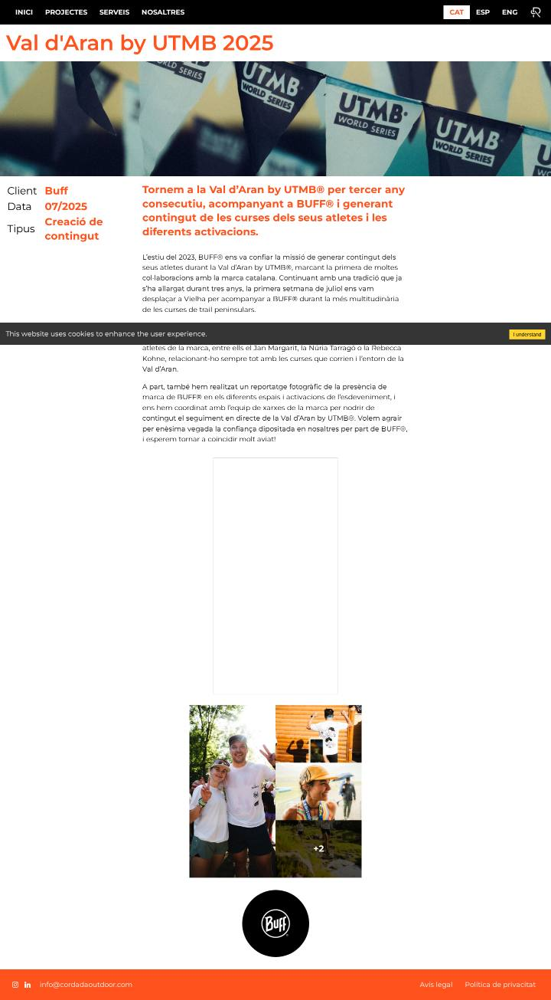 |
| Gallery lightbox | 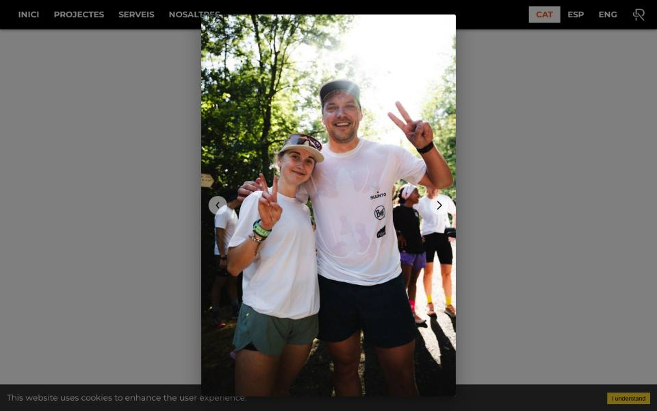 |
| 404 | 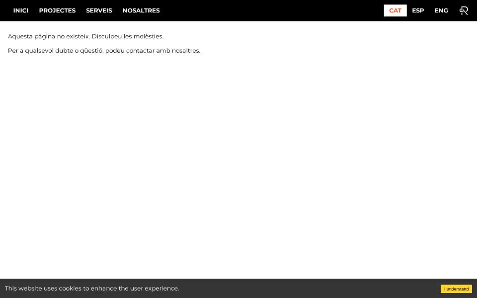 |
| Mobile home (fold) | 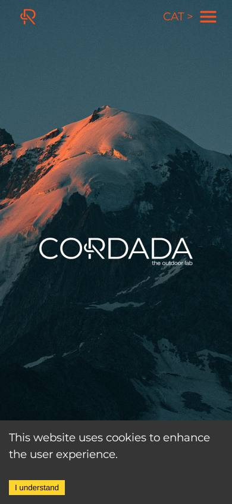 |
| Mobile home (full) | 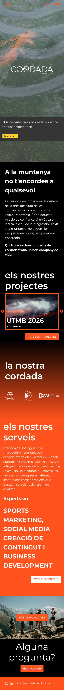 |
| Mobile drawer | 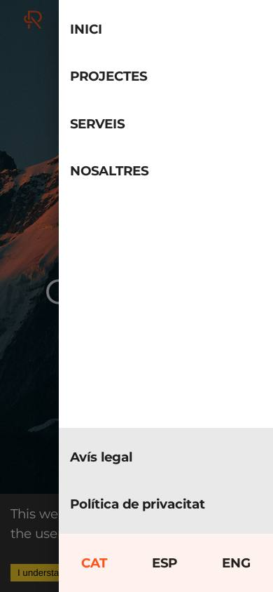 |
| Mobile projects | 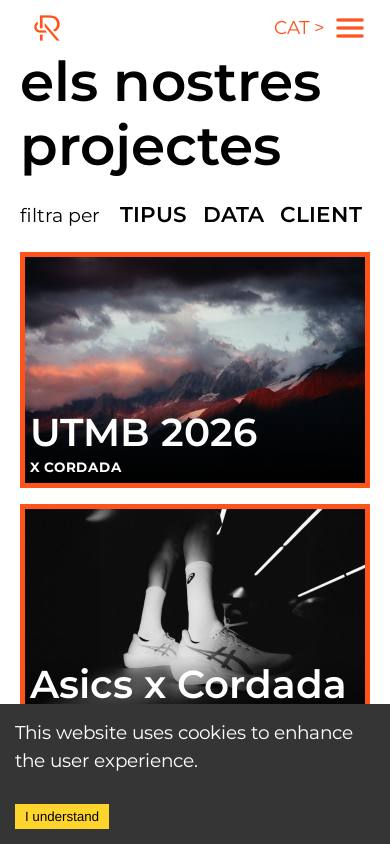 |
| Mobile single project | 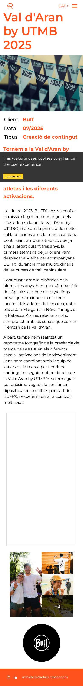 |
